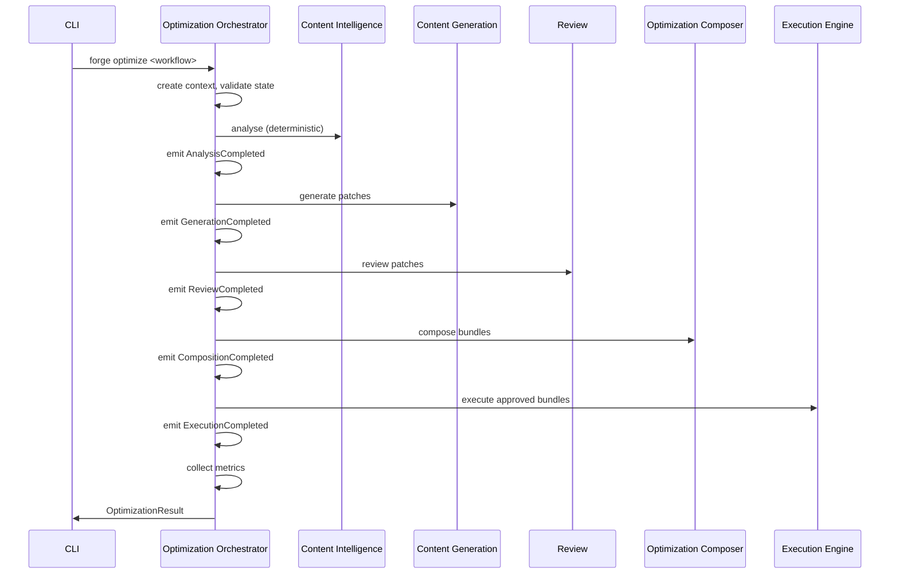
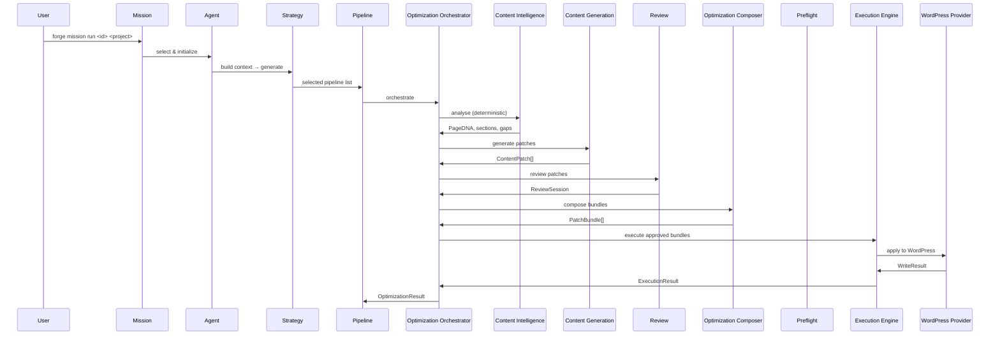
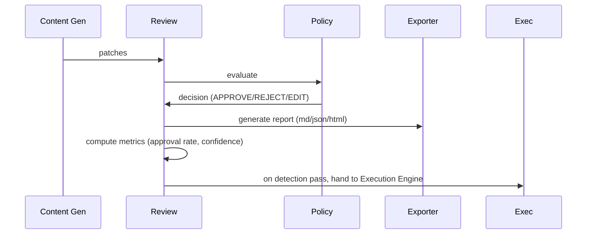
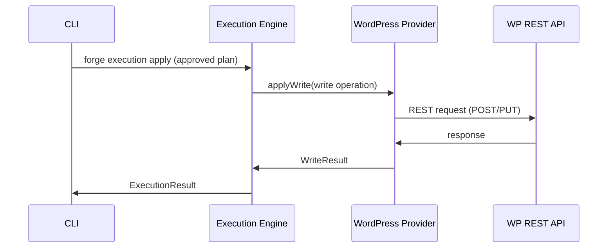

# Forge Architecture

**Version:** v0.24.0 (Sprint 24 — Site-Level Content Intelligence)

Forge is a layered, deterministic-first platform for autonomous website optimization. Every layer has a single responsibility and enforced boundaries.

---

## 1. Architecture Stack

```
┌────────────────────────────────────────────────────────────┐
│                       MISSION                              │
├────────────────────────────────────────────────────────────┤
│                        AGENT                               │
├────────────────────────────────────────────────────────────┤
│                      STRATEGY                              │
├────────────────────────────────────────────────────────────┤
│                      PIPELINE                              │
├────────────────────────────────────────────────────────────┤
│                OPTIMIZATION ORCHESTRATOR                    │
│  Central coordination — state machine, events, metrics     │
├────────────────────┬───────────────────────────────────────┤
│ CONTENT INTELLIGENCE│     CONTENT GENERATION / AI ENGINE    │
│ (deterministic,     │     (section-patch only, AI)         │
│  no AI)             │                                       │
│ KNOWLEDGE ENGINE    │     REVIEW ENGINE                     │
│ MEMORY ENGINE       │     (deterministic, no AI approves)   │
│                     │     OPTIMIZATION COMPOSER             │
│                     │     EXECUTION ENGINE (apply only)     │
├────────────────────┴───────────────────────────────────────┤
│                    PROVIDER                                 │
│  WordPress REST API (read/write/rollback/preview)          │
└────────────────────────────────────────────────────────────┘
```

---

## 2. Layer Responsibilities

### 2.1 Mission

| Aspect | Detail |
|---|---|
| **Purpose** | Define high-level goals and decompose them into steps |
| **Inputs** | Project context, available agents, skills, pipelines |
| **Outputs** | MissionPlan with sequenced steps (agent → strategy → pipelines) |
| **Determines** | What needs to happen and in what order |
| **Never generates** | Content, strategies, or execution plans |
| **Ownership** | `@forge/mission-engine` |

**Built-in missions:**

1. **Website Audit** — SEO audit of entire site.
2. **Weekly Optimization** — Content intelligence → agent review → generation → review → compose → execute.
3. **Homepage Optimization** — Detect → Intelligence → Generate → DOM → Review → Compose → Provide → Execute.

### 2.2 Agent

| Aspect | Detail |
|---|---|
| **Purpose** | Role-specific decision-making and context assembly |
| **Inputs** | AgentContext (project profile, knowledge, memory, findings, pipeline) |
| **Outputs** | AgentExecutionResult (strategy, decisions, metadata) |
| **May not** | Execute pipelines directly, write to WordPress, approve changes |
| **Ownership** | `@forge/agent-engine` |

**Registered agents:**

| Agent | Purpose | Supported Pipelines | Supported Skills |
|---|---|---|---|
| SEOAgent | SEO optimizations | analyze, recommend | generateSeoTitle, generateMetaDescription, generateAltText, generateOpenGraph, generateTwitterCard |
| ContentAgent | Content strategy & generation | read, recommend | expandThinContent, rewriteHeading, generateSection, generateHero, generateFaq, generateBlog |
| LinkingAgent | Internal linking strategy | read | generateInternalLinks |
| SchemaAgent | Rich schema management | read | generateFaqSchema |
| AccessibilityAgent | A11y improvements | analyze | — |
| PerformanceAgent | Performance monitoring | analyze | — |
| LearningAgent | Self-improvement, pattern mining | — | — |

### 2.3 Strategy

| Aspect | Detail |
|---|---|
| **Purpose** | Translate goals into prioritized pipeline selections |
| **Inputs** | StrategyContext (project, agents, pipelines, skills, providers) |
| **Outputs** | Strategy (goals, priorities, pipeline selections, risk level) |
| **Determines** | Execution ordering, approval integration, pipeline mapping, rollback planning |
| **Ownership** | `@forge/strategy-engine` |

### 2.4 Pipeline

| Aspect | Detail |
|---|---|
| **Purpose** | Execute steps in dependency-ordered sequence |
| **Inputs** | Pipeline definition + runtime context |
| **Outputs** | PipelineResult (status, duration, step outputs) |
| **Determines** | Step ordering, retry, skip logic |
| **Ownership** | `@forge/pipeline-engine` |

**Built-in pipelines:**

| Pipeline ID | Name | Step Sequence |
|---|---|---|
| `read` | Website Read | website-reader |
| `analyze` | Website Analyze | website-reader → website-reader → homepage-analysis |
| `recommend` | Recommend | website-reader → homepage-analysis → recommendation-engine |
| `plan` | Plan | website-reader → homepage-analysis → recommendation-engine → action-engine |
| `validate` | Validate | (analysis → action-engine) → preflight-validator |
| `execute` | Execute | (analysis → action-engine) → execute |

### 2.5 Content Intelligence

| Aspect | Detail |
|---|---|
| **Purpose** | Analyze and classify content 100% deterministically — at the page level AND at the site level (Sprint 24) |
| **Inputs** | `WebsiteSnapshot[]` (pages), optional `@forge/dom-engine` Universal Page Model structures, optional knowledge/memory context |
| **Outputs** | PageDNA, ContentGraph, Sections, Entities, Topics, QualityScores, ContentGaps — plus Site Content Model, Topic Graph, Topic Clusters, Authority/Coverage scores, Site Opportunities, Refresh Candidates, Internal Link Opportunities |
| **Deterministic** | Yes — no AI, no network calls, no prompt registry |
| **May import** | `core`, `shared`, `tools`, `logger` |
| **Must never import** | `ai-engine`, `prompt-registry`, `skills`, `providers-wordpress`, `must-execute`, `content-generation` |
| **Ownership** | `content-intelligence` |

**API surface (page level):**

- `buildPageDNA(snapshot, $)` → PageDNA (pageType, intent, audience, entities, topics)
- `buildContentGraph(snapshot, $)` → ContentGraph (nodes by type)
- `detectSections(snapshot, $)` → Sections (present / missing)
- `extractEntities(snapshot, $)` → Entity[]
- `extractTopics(snapshot)` → Topic[]
- `detectGaps(snapshot, $)` → ContentGap[]
- `scoreQuality(snapshot, $)` → QualityScore (overall, readability, depth, freshness, entity density)

### 2.5.1 Site-level Content Intelligence (Sprint 24)

Site-level Content Intelligence is an **extension of `@forge/content-intelligence`**, not a new engine. It composes the existing page-level outputs across all pages of a site so Forge understands the website as a complete content system.

```
Page-level Content Intelligence (PageDNA / ContentGraph / gaps / quality)
        ↓
Site-level Content Intelligence
        ↓
Knowledge / Memory
        ↓
Generation / Review / Optimization
```

**Data flow (all deterministic):**

1. `analyzeSite(snapshots, options)` composes each page through the existing PageDNA / ContentGraph / quality engines (`buildSitePageEntry`, `buildSiteContentModel` → `SiteContentModel`).
2. `buildTopicGraph(model)` derives deterministic topic relationships (related, supporting, parent/child via term inclusion and URL path, associated entities).
3. `buildTopicClusters(model, graph)` groups topics into clusters with primary topic, pages, supporting pages, missing coverage and a diagnostic coverage score.
4. `scoreSiteAuthority(...)` returns normalized Forge diagnostic scores (topical coverage, semantic depth, supporting content, internal linking, entity coverage, completeness, freshness). These are **not** Google rankings.
5. `detectRefreshCandidates(model)` flags pages needing refresh with reasons, affected dimensions, priority and evidence.
6. `detectInternalLinkOpportunities(model, clusters)` outputs link opportunities only — links are never modified here.
7. `detectSiteOpportunities(...)` extends the existing page-level gap detection with site-level opportunities, each referencing the underlying PageDNA / quality / section findings.

**Integration contract:**

- **DOM Engine** — the site layer consumes the Universal Page Model shape (`UniversalPageLike`) for sections, blocks and builder information. It never parses HTML itself.
- **Knowledge / Memory** — consumes `SiteAnalysisKnowledge` / `SiteAnalysisMemory` (structural shapes of the existing knowledge-engine and memory-engine) for brand, entities, keywords and history. Meaningful runs are recorded through the existing memory system as `site-analysis` events (`createSiteAnalysisMemoryEvent`).
- **Pipeline** — `site-intelligence` step and pipeline in `@forge/pipeline-engine`.
- **Optimization Orchestrator** — `createSiteIntelligenceEngine()` adapter exposes opportunities, refresh candidates, internal link opportunities and topic coverage gaps into the workflow context. It never executes anything.
- **CLI** — `forge content site-analyze|topics|clusters|authority|opportunities|refresh|links`.

**MVP boundary:** this layer is intelligence/planning only. No generation, no link modification, no scheduling, no dashboards, no persistence, no provider writes.

### 2.6 Content Generation

| Aspect | Detail |
|---|---|
| **Purpose** | Generate section-patch improvements using AI |
| **Inputs** | PageDNA, sections, project context, brand profile, AI engine |
| **Outputs** | ContentPatch[] with validation |
| **Must only generate** | Section patches (individual content blocks) |
| **Never publishes** | ✅ |
| **Never knows WordPress** | ✅ |
| **Never modifies HTML directly** | ✅ |
| **Never writes whole pages** | ✅ |
| **May import** | `core`, `shared`, `ai-engine`, `prompt-registry`, `tools`, `logger` |
| **Must never import** | `providers-wordpress`, `execution-engine`, `homepage-engine` |
| **Ownership** | `@forge/content-generation` |

**Section writers available (Sprint 20):**

| Writer | Section |
|---|---|
| `writeHero` | Hero (headline, subheadline, 2 CTAs) |
| `writeBenefits` | Benefits (3-5 benefit Cards) |
| `writeFeatures` | Features (3-6 feature Cards) |
| `writeServices` | Services (3-4 service descriptions) |
| `writeProducts` | Products (3-4 product Cards) |
| `writeAbout` | About (company narrative) |
| `writeFaq` | FAQ (5-8 Q&A pairs) |
| `writeTestimonials` | Testimonials (3-4 quotes) |
| `writeCta` | CTA (1-3 calls to action) |
| `writeBuyingGuide` | Buying guide (step-by-step) |
| `writeComparison` | Comparison (2--tier feature matrix) |
| `writeProduct` | Product (single product detail) |
| `writeIntroduction` | Introduction (page open) |
| `writeConclusion` | Conclusion (page close) |
| `writeContact` | Contact (form + info) |
| `writeBlog` | Blog (complete post) |

### 2.7 DOM Engine

| Aspect | Detail |
|---|---|
| **Purpose** | Canonical website parser. Transforms raw HTML into a Universal Page Model (Page → Regions → Sections → Blocks → Elements → Text Nodes → Attributes → Selectors). Everything that reads or writes HTML must use it. |
| **Inputs** | Raw HTML, WordPress post content, Elementor JSON, Gutenberg block markup |
| **Outputs** | UniversalPage (Page → Regions → Sections → Blocks → Elements → Text Nodes → Attributes → Selectors), DomDiff, RichTextModel, RichTextPatch, DomValidationReport |
| **Builder Detection** | Elementor (containers, sections, widgets), Gutenberg (blocks), Classic Editor, Bricks |
| **Selectors** | CSS selector, XPath, DOM path, stable Forge selector, section/block/attribute selectors |
| **Stable IDs** | Deterministic IDs for every region, section, block, element, text node |
| **Region Detection** | Header, Hero, Navigation, Breadcrumb, Main, Sidebar, Footer, Popup, Modal, Sticky, Hidden, Template parts |
| **Semantic Detection** | Hero, Benefits, Services, Products, Features, Testimonials, FAQ, Comparison, CTA, Pricing, Contact, About, Blog, Resources, Related, Team, Mission, Vision, Timeline, Statistics, Partners, Clients, Awards, Trust, Newsletter, Footer |
| **DOM Diff** | Added/removed/modified/moved nodes, attribute changes, structural changes |
| **Rich Text Model** | Headings, paragraphs, lists, tables, links, buttons, inline formatting, images, embeds, forms |
| **DOM Validation** | Broken nesting, invalid heading order, duplicate IDs, empty sections, hidden content, broken images, malformed lists/tables, missing landmarks, invalid ARIA |
| **Deterministic** | Yes — no AI, no network, no provider calls |
| **Public APIs** | `parse()`, `buildUniversalPage()`, `detectBuilder()`, `buildSelectors()`, `buildStableIds()`, `diffDom()`, `normalizeRichText()`, `createPatch()`, `validateDom()` |
| **Ownership** | `@forge/dom-engine` |
| **CLI commands** | `forge dom analyze`, `forge dom tree`, `forge dom diff`, `forge dom validate`, `forge dom selectors`, `forge dom builder`, `forge dom export` |

### 2.8 Review

| Aspect | Detail |
|---|---|
| **Purpose** | Deterministic review and approval of generated patches |
| **Inputs** | ContentPatch[], ReviewPolicy |
| **Outputs** | ReviewSession, decisions, metrics, reports |
| **Deterministic** | ✅ — no AI in review; AI never approves |
| **Ownership** | `@forge/review-engine` |

**Review policies:**
- `strict` — all changes require explicit approval
- `balanced` — safe changes auto-approve, medium/high require human
- `automatic` — safe + medium auto-approve
- `enterprise` — multi-step permission with security checks

**Review session methods:**
- `createReviewSession` — initialize session
- `decideItem` — APPROVE / REJECT / EDIT
- `generateReport` — md / json / html export
- `computeMetrics` — approval rate, rejection rate, avg confidence, high-risk change count
- `saveReviewSession` / `loadReviewSession` — persistence

### 2.9 Optimization Composer

| Aspect | Detail |
|---|---|
| **Purpose** | Transform reviewed patches into optimized, dependency-aware, prioritized bundles |
| **Inputs** | ReviewSession, ContentPatch[] |
| **Outputs** | PatchBundle[], DependencyGraph, ConflictReport, PrePatch |
| **Never generates content** | ✅ |
| **Never knows providers** | ✅ |
| **Must never import** | `content-generation`, `providers-wordpress` |
| **Ownership** | `@forge/optimization-composer` |

**Composer steps:**
1. **Deduplication** — eliminate duplicate patches
2. **Dependency graph** — build DAG (patch A must run before patch B)
3. **Conflict detection** — flag patches targeting same selector
4. **Priority ordering** — critical → high → medium → low
5. **Rollback groups** — group patches by atomic undo
6. **Pre-package** — produce `forge compose preview` output
7. **Batch validation** — validate all bundles (`forge compose validate`)

### 2.10 Execution Engine

| Aspect | Detail |
|---|---|
| **Purpose** | Execute approved, validated actions against providers |
| **Inputs** | ExecutionPlan, Provider |
| **Outputs** | ExecutionResult (completedActions, failedActions, skippedActions, rollbackPlan) |
| **Never generates content** | ✅ |
| **Never plans** | ✅ |
| **Never decides** | ✅ |
| **Never reviews** | ✅ |
| **Ownership** | `@forge/execution-engine` |

### 2.11 Optimization Orchestrator

| Aspect | Detail |
|---|---|
| **Purpose** | Central orchestration that coordinates all engines into one deterministic workflow |
| **Inputs** | WorkflowDefinition, OptimizationContext |
| **Outputs** | OptimizationResult with execution results, metrics, events |
| **State machine** | Deterministic — every transition validated |
| **Engine registry** | Resolves content-intelligence, content-generation, review, composer, execution, knowledge, memory, AI engine |
| **Event system** | Typed events consumable by Knowledge Engine, Memory Engine, future Dashboard |
| **Never generates** | Content, plans, or strategies |
| **Never knows** | WordPress, Elementor, or any specific provider |
| **May import** | core, shared, logger, content-intelligence, content-generation, review-engine, optimization-composer, execution-engine, ai-engine, knowledge-engine, memory-engine |
| **Must never import** | providers-wordpress, dom-engine, homepage-engine, agent-engine, strategy-engine, mission-engine |
| **Ownership** | `@forge/optimization-orchestrator` |

**Lifecycle states:**
```
Created → Prepared → Analysing → Generating → Reviewing → Composing → Validated → Ready → Executing → Completed
                                                                                                     Cancelled
                                                                                                     Failed
                                                                                                     RolledBack
```

**Workflow definitions (declarative):**

| Workflow | Steps |
|---|---|
| `homepage-optimization` | Analyse → Generate → Review → Compose → Validate → Execute |
| `blog-optimization` | Analyse → Generate → Review → Compose → Validate → Execute |
| `landing-page-optimization` | Analyse → Generate → Review → Compose → Validate → Execute |
| `product-page-optimization` | Analyse → Generate → Review → Compose → Validate → Execute |
| `category-optimization` | Analyse → Generate → Review → Compose → Validate → Execute |
| `content-refresh` | Analyse → Review → Compose → Validate → Execute |

**Orchestrator flow:**



### 2.12 Provider (WordPress)

| Aspect | Detail |
|---|---|
| **Purpose** | Read/write/rollback/preview content on WordPress sites |
| **Inputs** | Provider config + WriteOperation / ReadRequest |
| **Outputs** | ProviderResult, SiteInfo, Capabilities |
| **Ownership** | `@forge/providers-wordpress` |

**Read capabilities:** posts, pages, pages, media, categories, tags, settings, siteInfo, capabilities

**Write capabilities:** update, create, preview, rollback

**Limitations:** No browser automation, no visual builder integration, no elementor of any visual builder support

---

## 3. Dependency Graph

```
core ← shared < shared
                     ↓
    tools ← capabilities ← recommendation-engine ← action-engine
      ↓                        ↓                        ↓
    config ← plugin-registry ← preflight-validator ← execution-engine
      ↓                                                         ↓
    pipeline-engine ← agent-engine ← strategy-engine ← mission-engine
      ↓                          ↓              ↓
    homepage-engine          skills ← prompt-registry
      ↓                          ↓              ↓
   content-intelligence  content-generation provider-wordpress
      ↓                          ↓              ↓
    dom-engine              review-engine  optimization-composer
      │                          ↓              │
      └──────────────────────────┴──────────────┘
                                     ↓
                           optimization-orchestrator
                                     ↓
                         (consumes all engines above)
```

### Import Rules by Package

| Package | May Import | Must Never Import |
|---|---|---|
| `core` | (no Forge packages) | all other packages |
| `shared` | core | — |
| `logger` | core | — |
| `config` | core | — |
| `tools` | core, shared, logger | — |
| `capabilities` | core, shared, tools | ai-engine, skills, providers, execution |
| `plugin-registry` | core, shared | — |
| `recommendation-engine` | core, shared, tools | ai-engine, execution |
| `action-engine` | core, shared, recommendation-engine | ai-engine, providers |
| `pipeline-engine` | core, shared | — |
| `preflight-validator` | core, shared, action-engine | providers |
| `execution-engine` | core, shared, action-engine, preflight-validator, providers | content-generation, skills, prompt-registry |
| `providers-wordpress` | core, shared, config, logger | ai-engine, content-generation, skilled |
| `project-resolver` | core, shared | — |
| `knowledge-engine` | core, shared | — |
| `memory-engine` | core, shared, knowledge-engine | — |
| `context-builder` | core, shared | — |
| `content-intelligence` | core, shared, tools, logger | ai-engine, prompt-registry, skills, providers, execution-engine, content-generation |
| `content-generation` | core, shared, ai-engine, prompt-registry, skills | providers-wordpress, execution-engine, homepage-engine, optimization-composer |
| `dom-engine` | core, shared, tools, content-intelligence | providers, execution, content-generation |
| `ai-engine` | core, shared, config, memory, prompt-registry | providers-wordpress, content-intelligence, execution |
| `skills` | core, shared, ai-engine, prompt-registry | providers-wordpress, execution |
| `prompt-registry` | core, shared | — |
| `agent-engine` | core, shared, skills, pipeline-engine, strategy-engine, mission-engine | content-intelligence, content-generation, execution |
| `strategy-engine` | core, shared, pipeline-engine | — |
| `mission-engine` | core, shared, pipeline-engine, agent-engine, strategy-engine | content-generation, providers |
| `review-engine` | core, shared, action-engine | ai-engine, content-generation, skills |
| `optimization-composer` | core, shared, content-intelligence, review-engine | content-generation, providers, execution-engine |
| `homepage-engine` | core, shared, tools, content-intelligence, content-generation, review-engine, execution-engine | providers (directly; uses via exec) |
| `optimization-orchestrator` | core, shared, logger, content-intelligence, content-generation, review-engine, optimization-composer, execution-engine, ai-engine, knowledge-engine, memory-engine | providers-wordpress, dom-engine, homepage-engine, agent-engine, strategy-engine, mission-engine |

---

## 4. Execution Chains

### 4.1 Mission → Execute



### 4.2 Review Flow



### 4.3 Provider Flow



---

## 5. Sprint History

| Sprint | Summary |
|---|---|
| 1 | Project scaffold, logging, baseline standards |
| 7 | Preflight validation, execute (dry-run) |
| 8 | Homepage engine, analysis → plan pipeline |
| 9 | Plugin system, playwright, knowledge, connection |
| 10 | Installation, play provisioning |
| 11 | CLI developer tools, test, benchmark |
| 12 | QA round, generator, test consolidation |
| 13 | Vision v0.6, dimension expansion |
| 14–15 | Agent Framework, Golden acquisition |
| 16 | Content Intelligence (deterministic core) |
| 17 | Content Generation (section-patch only) |
| 18 | Review Engine (deterministic, AI-never-accepts) |
| 19 | AI Engine (provider factory, rate limiter, retry, cost tracker) |
| 20 | Writers (22 section writers, brand profile, voice detection) |
| 21 | Mission Engine, Strategy Engine, Optimization Composer |
| 22A | Architecture consolidation — documentation sync |
| 22B | Optimization Orchestrator — centralized orchestration layer |
| 23 | DOM Engine & Universal Page Model — canonical parser, builder detection, stable IDs, selectors, DOM diff, rich text, validation |

---

*This document supersedes all previous architecture.md versions. Updated Sprint 23 with DOM Engine & Universal Page Model.*
