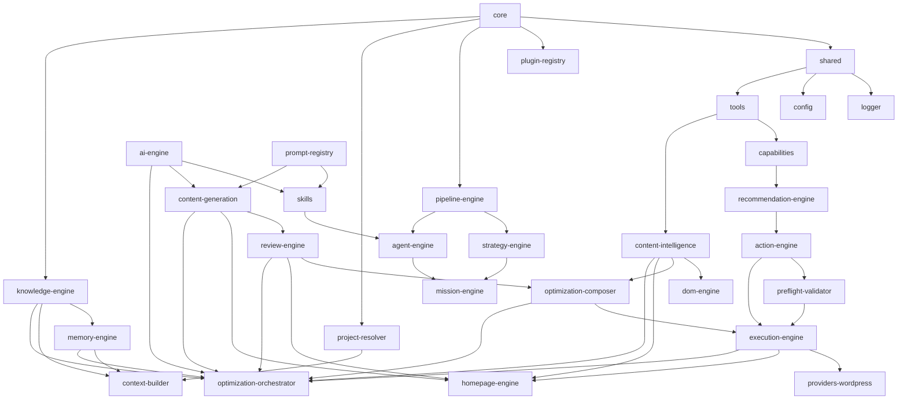

# Forge Dependency Graph

**Version:** v0.25.0 (Sprint 25)

## Package Dependency DAG



## Layer Stack

```
┌────────────────────────────────────────────────────────────┐
│  Orchestration Layer                                       │
│  mission-engine, agent-engine, strategy-engine             │
├────────────────────────────────────────────────────────────┤
│  Pipeline Layer                                            │
│  pipeline-engine                                           │
├────────────────────────────────────────────────────────────┤
│  Intelligence Layer                                        │
│  content-intelligence (deterministic)                      │
├────────────────────────────────────────────────────────────┤
│  AI Layer                                                  │
│  ai-engine, skills, prompt-registry, content-generation    │
├────────────────────────────────────────────────────────────┤
│  DOM Layer                                                 │
│  dom-engine                                                │
├────────────────────────────────────────────────────────────┤
│  Quality Layer                                             │
│  review-engine (deterministic)                             │
├────────────────────────────────────────────────────────────┤
│  Optimization Layer                                        │
│  optimization-composer (deterministic)                     │
├────────────────────────────────────────────────────────────┤
│  Execution Layer                                           │
│  preflight-validator, execution-engine                     │
├────────────────────────────────────────────────────────────┤
│  Provider Layer                                            │
│  providers-wordpress                                       │
├────────────────────────────────────────────────────────────┤
│  Foundation Layer                                          │
│  core, shared, config, logger, tools, plugin-registry      │
│  project-resolver, knowledge-engine, memory-engine         │
│  context-builder                                           │
└────────────────────────────────────────────────────────────┘
```

## Import Rules (Consolidated)

### Foundation Layer

| Package | May Import | Must Never Import |
|---|---|---|
| `core` | (none) | All other packages |
| `shared` | core | Any layer package |
| `config` | core | Any other packages |
| `logger` | core | Any other packages |
| `tools` | core, shared, logger | Any other packages |
| `plugin-registry` | core, shared | Any other packages |
| `project-resolver` | core, shared | Any other packages |
| `knowledge-engine` | core, shared | Any other packages |
| `memory-engine` | core, shared, knowledge-engine | skills, ai-engine, content-generation |
| `context-builder` | core, project-resolver, knowledge-engine, memory-engine | content-generation, providers |

### Analysis Layer

| Package | May Import | Must Never Import |
|---|---|---|
| `capabilities` | core, shared, tools | ai-engine, skills, providers, execution, content-generation |
| `recommendation-engine` | core, shared, tools | ai-engine, execution, providers |
| `action-engine` | core, shared, recommendation-engine | ai-engine, providers |

### Pipeline & Orchestration Layer

| Package | May Import | Must Never Import |
|---|---|---|
| `pipeline-engine` | core, shared | ai-engine, providers, content-generation |
| `agent-engine` | core, shared, skills, pipeline-engine | content-intelligence, content-generation, providers, execution |
| `strategy-engine` | core, shared, pipeline-engine | providers, content-generation |
| `mission-engine` | core, shared, pipeline-engine, agent-engine, strategy-engine | content-generation, providers |

### Intelligence Layer

| Package | May Import | Must Never Import |
|---|---|---|
| `content-intelligence` | core, shared, tools, logger | ai-engine, prompt-registry, skills, providers, execution-engine, content-generation |

### AI Layer

| Package | May Import | Must Never Import |
|---|---|---|
| `ai-engine` | core, shared, config, logger | providers-wordpress, content-intelligence, execution-engine |
| `prompt-registry` | core, shared | Any other packages |
| `skills` | core, shared, ai-engine, prompt-registry | providers-wordpress, execution-engine |
| `content-generation` | core, shared, ai-engine, prompt-registry, skills, tools | providers-wordpress, execution-engine, homepage-engine, optimization-composer |

### DOM Layer

| Package | May Import | Must Never Import |
|---|---|---|
| `dom-engine` | core, shared, tools, content-intelligence | providers, execution-engine, content-generation |

> **Sprint 25 (Elementor write bridge):** no new package edges were added. The bridge lives in the CLI composition root (`apps/cli/src/elementor/bridge.ts`), which already depends on dom-engine, providers-wordpress, and execution-engine. The provider's Elementor transport (`providers-wordpress/src/elementor-transport.ts`) imports only core + the package's own client — it does not import dom-engine. Follow-up cleanup removed dom-engine's unused workspace dependencies (`ai-engine`, `content-generation`, `core`, `execution-engine`, `knowledge-engine`, `prompt-registry`, `review-engine`); its manifest now declares only `content-intelligence` + `cheerio`, matching its actual imports.

### Quality Layer

| Package | May Import | Must Never Import |
|---|---|---|
| `review-engine` | core, shared, action-engine | ai-engine, content-generation, skills |

### Optimization Layer

| Package | May Import | Must Never Import |
|---|---|---|
| `optimization-composer` | core, shared, content-intelligence, review-engine | content-generation, providers, execution-engine |

### Execution Layer

| Package | May Import | Must Never Import |
|---|---|---|
| `preflight-validator` | core, shared, action-engine | providers, content-generation |
| `execution-engine` | core, shared, action-engine, preflight-validator, providers-wordpress | content-generation, skills, ai-engine |

### Provider Layer

| Package | May Import | Must Never Import |
|---|---|---|
| `providers-wordpress` | core, shared, config, logger | ai-engine, content-generation, skills |

### Domain-Specific Layer

| Package | May Import | Must Never Import |
|---|---|---|
| `homepage-engine` | core, shared, tools, content-intelligence, content-generation, review-engine, execution-engine | providers (directly; uses via exec) |

## Anti-Pattern Catalog

These import patterns would violate the architecture:

| Violation | Why It's Wrong |
|---|---|
| `content-intelligence` imports `ai-engine` | Intelligence must be deterministic. AI would introduce non-determinism. |
| `content-generation` imports `providers-wordpress` | Generation must never publish. Knowing WordPress would enable publishing. |
| `review-engine` imports `ai-engine` | Review must be deterministic. AI cannot approve changes. |
| `execution-engine` imports `content-generation` | Execution must never generate content. |
| `ai-engine` imports `providers-wordpress` | AI Engine must not know about specific providers. |
| `optimization-composer` imports `content-generation` | Composer must never generate content. |
| `dom-engine` imports `providers-wordpress` | DOM Engine must not know about providers. |
| `agent-engine` imports `content-intelligence` | Agents orchestrate; they don't analyze content directly. |
| `optimization-orchestrator` imports `providers-wordpress` | Orchestrator must be provider-independent. |
| `optimization-orchestrator` imports `dom-engine` | Orchestrator coordinates engines, not DOM operations. |

## Dependency Hygiene

Manifests must match reality. `pnpm check:deps` (`scripts/audit-unused-deps.mjs`) fails the build when a package declares a dependency (workspace or external) that its source never imports. It counts type-only imports, test files, subpath imports, CLI tools invoked in `scripts`, and `@types/*` referenced in `tsconfig` — so it only flags genuinely orphaned declarations.

**Sprint 25 follow-up cleanup:** 38 unused dependency declarations were removed across 16 packages (dom-engine alone: `ai-engine`, `content-generation`, `core`, `execution-engine`, `knowledge-engine`, `prompt-registry`, `review-engine`). Every removal was verified by full `build`/`typecheck`/`test` runs. Notably, `execution-engine` never imported `providers-wordpress` — it consumes the provider-agnostic `WriteProvider` from `@forge/core` — so the earlier ADR-054 workspace-cycle concern was based on dead declarations, not real code.
